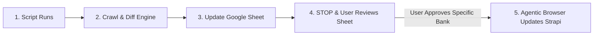

# Autonomous FD Rate Sync Engine (Sheet-First Review Process)

A 2-stage operational system designed to ensure 100% human verification before any production CMS (Strapi) updates are made.

---

## 📌 Standard Operating Procedure (SOP)



### Core Rule:
> **"I will check sheet first then update kiya jyega"**
> 
> The system **NEVER** writes or syncs to Strapi CMS automatically. 
> It updates the Google Sheet with color-coded rate comparisons, generates a summary, and pauses. Only after you manually review the sheet and explicitly command which bank(s) to update, the Browser Agent touches Strapi.

---

## Directory Structure

```text
fd_rate_sync_engine/
├── config/
│   └── banks_config.json          # Mapping of 20 Banks, Official URLs, and Strapi IDs (1 to 26)
├── src/
│   ├── compare_and_diff.ps1       # Normalizes tenures, calculates rate diffs, detects content contradictions
│   └── sync_sheets.ps1            # Updates Google Sheet with color-coded comparison tabs
├── data/
│   ├── diff_summary.json          # Structured diff payload generated by comparator
│   └── sheet_batch.json           # Payload generated for gsheets API
├── run_supervised_pipeline.ps1    # Stage 1 Runner (Crawl -> Diff -> Update Sheet -> Stop)
└── README.md                      # Operational Documentation
```

---

## How to Run Stage 1 (Update Sheet & Review)

Run the pipeline:
```powershell
powershell -ExecutionPolicy Bypass -File "C:\Users\parveen.kumar\.gemini\antigravity\scratch\fd_rate_sync_engine\run_supervised_pipeline.ps1"
```

### What Happens:
1. Crawls all official bank portals and ET Money pages.
2. Compares rates and formats differences:
   - 🟩 **Green Rows:** Rate Hikes
   - 🟥 **Red Rows:** Rate Cuts
   - 🟨 **Yellow Rows:** New Special Slabs
3. Pushes updates to [Google Sheet](https://docs.google.com/spreadsheets/d/1oeSytWn5llasTaoYlqZp7DiPNA5-_xylB-4hPKAFzEY/edit).
4. Prints the review link and **STOPS**.

---

## Stage 2: Updating Strapi (Only After You Review)

Once you review a bank in the Google Sheet, simply instruct the agent:
> *"Maine Bank of Baroda check kar liya hai, isko Strapi mein update kar do"*

The Browser Agent will then:
1. Open that specific bank's Strapi entry (`/fdpartner/{id}`).
2. Update the revised date (`w.e.f.`) and rate table.
3. Check and correct any contradictory FAQs or SEO text.
4. Save and verify database persistence.

---

## ☁️ Cloud Execution: GitHub Actions (Runs Even If Laptop Is OFF)

The workflow file is configured at `.github/workflows/weekly_fd_sync.yml`:
- **Schedule:** Runs every Monday at `09:00 AM IST` (`03:30 AM UTC`) on GitHub's cloud runners.
- **Manual Trigger:** Can also be triggered anytime via GitHub UI (`Run workflow` button).
- **Environment Variable / Secret:**
  - `GOOGLE_SERVICE_ACCOUNT_KEY`: Google Service Account JSON credentials with Editor access to spreadsheet `1oeSytWn5llasTaoYlqZp7DiPNA5-_xylB-4hPKAFzEY`.
- **Security Policy:**
  - Same strict SOP: The GitHub Action **only** updates Google Sheets and commits artifacts.
  - Strapi CMS is **never** touched from GitHub Actions.

